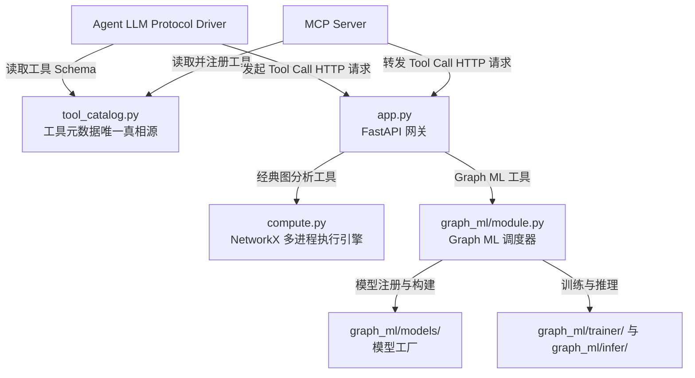
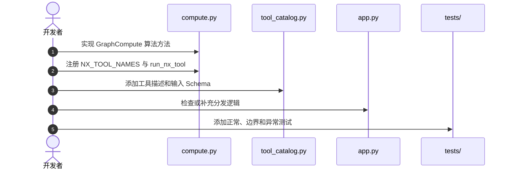
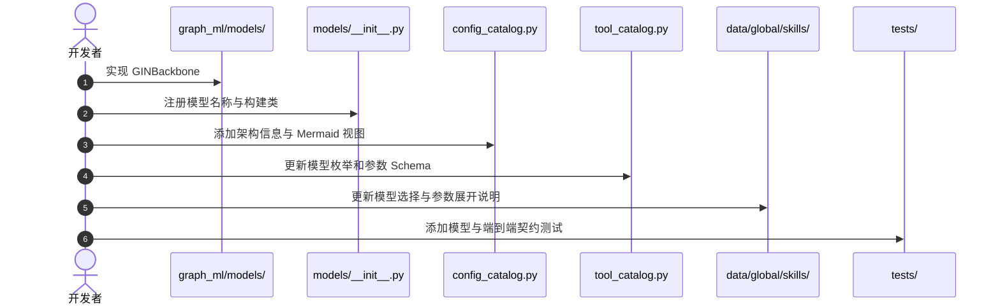

# iGraph 图工具与算法接口规范及开发指南

本文档面向 iGraph 项目的工具开发者，说明经典图分析工具（Graph Analysis Tools）与图机器学习工具（Graph ML Tools）的整体架构、接口约定、扩展流程和测试要求。

本文重点回答以下问题：

- 图工具的声明、调用、执行和返回结果分别由哪些模块负责；
- 如何新增一个经典图算法工具；
- 如何新增一个 GNN Backbone；
- 如何新增一个独立的 Graph ML 工具；
- 何时需要同步更新 Agent Skill；
- 如何验证新增能力满足系统契约。

---

## 1. 系统架构

### 1.1 设计原则

iGraph 的图工具体系遵循以下三项设计原则：

1. **声明与实现分离**：工具的名称、描述和输入 Schema 与具体计算逻辑分开维护。
2. **统一工具目录**：`tool_catalog.py` 是工具元数据的唯一真相源（Single Source of Truth，SSOT）。MCP Server、FastAPI 网关和 Agent 协议层均从该文件读取工具定义。
3. **双执行链路解耦**：经典图分析由 NetworkX 执行，图机器学习任务由 PyG 相关模块执行，两类工具共享统一的调用入口和返回格式。

系统中的工具分为两类：

- **经典图分析工具**：用于最短路径、中心性、社区检测、子图提取等确定性图计算；
- **图机器学习工具**：用于模型训练、推理、评估和架构可视化等任务。

### 1.2 工具调用链路



经典图工具和 Graph ML 工具具有不同的底层执行路径，但都经过以下统一过程：

1. Agent 或 MCP Server 从 `tool_catalog.py` 获取工具声明；
2. 工具调用通过 HTTP 请求进入 `app.py`；
3. `app.py` 根据工具类型将请求分发到 NetworkX 或 Graph ML 执行模块；
4. 执行模块返回统一的 JSON 字典；
5. Agent 解析结果并继续后续任务。

### 1.3 核心文件与职责

| 文件路径 | 主要职责 | 说明 |
| :--- | :--- | :--- |
| [`graph_data_service/tool_catalog.py`](../graph_data_service/tool_catalog.py) | 工具元数据唯一真相源 | 集中定义 `GRAPH_TOOLS` 和 `GRAPH_ML_TOOLS` 的名称、描述、分类及 JSON Schema。下游模块应直接引用该文件，避免重复维护工具声明。 |
| [`graph_data_service/compute.py`](../graph_data_service/compute.py) | 经典图算法实现与执行 | 包含 `GraphCompute` 类及具体 NetworkX 算法，并通过 `run_nx_tool` 提供统一的多进程执行入口。 |
| [`graph_data_service/graph_ml/`](../graph_data_service/graph_ml/) | Graph ML 核心模块 | 包含模型定义、模型工厂、训练器、推理器、配置 Schema、架构可视化和统一调度入口。 |
| [`graph_data_service/app.py`](../graph_data_service/app.py) | API 网关与工具分发 | 实现 FastAPI 路由，并通过 `execute_tool` 和 `_dispatch_graph_ml_tool` 分发两类工具。 |
| [`mcp_service/server.py`](../mcp_service/server.py) | MCP 协议服务 | 从工具目录自动注册工具，并将 MCP `tool_call` 转换为对 FastAPI 网关的 HTTP 请求。 |
| [`backend/agent/protocol.py`](../backend/agent/protocol.py) | Agent 工具协议适配 | 将工具目录转换为 System Prompt 或 Native Function Calling 所需的工具格式。 |
| [`data/global/skills/`](../data/global/skills/) | Agent Skill 指令包 | 描述工具的激活条件、调用顺序、上下文要求、参数展开规则和结果解析方式。 |

### 1.4 不同扩展任务需要修改的模块

| 扩展任务 | 必须修改 | 按需修改 |
| :--- | :--- | :--- |
| 新增经典图算法工具 | `compute.py`、`tool_catalog.py`、测试文件 | `app.py`、Agent Skill |
| 新增通用框架支持的 GNN Backbone | `graph_ml/models/`、模型注册表、`config_catalog.py`、`tool_catalog.py`、测试文件 | Agent Skill |
| 新增独立 Graph ML API 工具 | Graph ML 实现模块、`tool_catalog.py`、`app.py`、测试文件 | Agent Skill、架构可视化模块 |
| 仅调整工具描述或输入参数 | `tool_catalog.py` | Agent Skill、协议兼容性测试 |

---

## 2. 工具接口契约

所有图工具均应遵循统一的输入和输出契约。工具实现不得绕过会话上下文，也不得返回无法被 JSON 序列化的对象。

### 2.1 输入参数

一次工具调用由隐式上下文和显式参数两部分组成。

#### 2.1.1 隐式上下文

隐式上下文由服务端维护，不应要求 Agent 在算法参数中重复提供。

- `session_id`：用于检索当前会话绑定的 `GraphData`、NetworkX 图、Graph ML 数据集或已训练模型；
- `user_id`（可选）：用于标识用户及隔离相关资源。

#### 2.1.2 显式算法参数

显式参数统一放在 `arguments: Dict[str, Any]` 中，并在 `tool_catalog.py` 的 `inputSchema` 中通过 JSON Schema 定义。

经典图工具的常见参数包括：

- 节点或边标识：`source`、`target`、`node`；
- 算法选择：如 `louvain`、`yen_k_shortest`；
- 搜索或截断参数：`k`、`cutoff`、`limit`。

Graph ML 工具的常见参数包括：

- 任务类型：`task`；
- 模型名称：`model`；
- 数据配置：`data`；
- 训练配置：`train_config`；
- 算法或模型配置：`algo_config`；
- 推理查询：`query`。

### 2.2 成功响应

所有工具均返回 JSON 字典。成功响应至少应包含 `success: true`，其他字段根据工具功能定义。

```json
{
  "success": true,
  "result_field_1": "...",
  "result_field_2": [],
  "truncated": false,
  "message": "可选的说明信息"
}
```

字段设计应满足以下要求：

- 字段名称能够直接表达结果含义；
- 数值、字符串、列表和字典均可被 JSON 序列化；
- 不应直接返回 NetworkX、PyTorch 或 PyG 对象；
- 可选说明放入 `message`，核心结果不应仅存在于自然语言文本中。

### 2.3 失败响应

参数校验失败、数据状态不满足要求或底层执行异常时，应返回结构化错误信息：

```json
{
  "success": false,
  "error": "明确的错误提示信息"
}
```

错误信息应说明失败原因，例如：

- 节点不存在；
- 当前会话尚未加载图数据；
- 模型 ID 无效；
- 参数类型或取值范围不合法；
- 模型训练或推理失败。

### 2.4 结果截断

图工具可能产生大规模节点、边或预测列表。为避免返回内容超过 Agent 上下文限制，工具应使用 `_truncate`、`result_limit` 或同类机制限制输出规模。

当结果被截断时，应同时返回：

```json
{
  "success": true,
  "items": [],
  "truncated": true,
  "total_count": 500
}
```

默认列表上限通常为 20 至 50 条。具体工具可通过 `limit` 参数允许调用方调整上限，但仍应保留服务端安全限制。

---

## 3. 新增经典图算法工具

本节以个性化 PageRank 工具 `personalized_pagerank` 为例，说明经典图算法的完整扩展流程。

### 3.1 扩展流程



对于可通过 `run_nx_tool` 通用分发的工具，通常无需在 `app.py` 中增加专用路由。只有当工具需要特殊数据准备或特殊执行路径时，才需要修改 `app.py`。

### 3.2 实现算法逻辑

在 `graph_data_service/compute.py` 的 `GraphCompute` 类中添加算法方法：

```python
def personalized_pagerank(
    self,
    g: nx.DiGraph,
    reset_node: str,
    alpha: float = 0.85,
    limit: Optional[int] = None,
) -> dict:
    """计算指定 reset_node 的 Personalized PageRank。"""
    if reset_node not in g:
        return {
            "success": False,
            "error": f"节点 '{reset_node}' 不存在于图中。",
        }

    personalization = {node: 0.0 for node in g.nodes()}
    personalization[reset_node] = 1.0

    try:
        scores = nx.pagerank(
            g,
            alpha=alpha,
            personalization=personalization,
        )
        sorted_scores = sorted(
            scores.items(),
            key=lambda item: item[1],
            reverse=True,
        )

        effective_limit = _effective_limit(
            limit,
            default=_MAX_LIST_ITEMS,
        )
        rankings, truncated = _truncate(
            [
                {"node": node, "score": round(score, 6)}
                for node, score in sorted_scores
            ],
            limit=effective_limit,
        )

        result = {
            "success": True,
            "reset_node": reset_node,
            "alpha": alpha,
            "rankings": rankings,
        }
        if truncated:
            result["truncated"] = True
            result["total_nodes"] = len(sorted_scores)
        return result
    except Exception as exc:
        return {
            "success": False,
            "error": f"计算 Personalized PageRank 失败: {exc}",
        }
```

实现时应重点保证：

- 在执行算法前完成必要的节点、边和参数校验；
- 捕获底层算法异常并返回结构化错误；
- 对大规模列表结果进行截断；
- 返回结果中的节点标识和数值均可被 JSON 序列化。

### 3.3 注册执行入口

将工具名称加入 `NX_TOOL_NAMES`，并在 `run_nx_tool` 中添加分发逻辑：

```python
NX_TOOL_NAMES: frozenset = frozenset({
    # ... existing tools ...
    "personalized_pagerank",
})


def run_nx_tool(
    tool_name: str,
    g: nx.DiGraph,
    arguments: dict,
) -> dict:
    # ... common argument handling ...
    if tool_name == "personalized_pagerank":
        return c.personalized_pagerank(
            g,
            reset_node=str(a.get("reset_node", "")),
            alpha=float(a.get("alpha", 0.85)),
            limit=lim,
        )

    # ... other tools ...
```

`NX_TOOL_NAMES` 决定工具是否进入 NetworkX 执行链路，`run_nx_tool` 则负责将标准化参数传入具体算法方法。新增工具时，两处注册应保持一致。

### 3.4 添加工具声明

在 `graph_data_service/tool_catalog.py` 的 `GRAPH_TOOLS` 中添加工具元数据和 JSON Schema：

```python
{
    "name": "personalized_pagerank",
    "description": (
        "计算以 reset_node 为个性化起点的 PageRank 得分，"
        "并按得分从高到低返回节点排序。\n\n"
        "参数:\n"
        "- reset_node（必需）：个性化 PageRank 的起始节点。\n"
        "- alpha（可选，默认 0.85）：阻尼系数，取值范围为 0 到 1。\n"
        "- limit（可选）：返回的最大节点数量。\n\n"
        "返回:\n"
        "- JSON 对象，其中 rankings 为节点及其得分的排序列表。"
    ),
    "inputSchema": {
        "type": "object",
        "properties": {
            "reset_node": {
                "type": "string",
                "description": "个性化 PageRank 的起始节点",
            },
            "alpha": {
                "type": "number",
                "description": "阻尼系数，默认为 0.85",
                "default": 0.85,
            },
            "limit": {
                "type": "integer",
                "description": "返回结果的最大条数",
            },
        },
        "required": ["reset_node"],
    },
    "category": "centrality",
}
```

工具声明应与实现保持一致，尤其需要检查：

- 工具名称是否与 `NX_TOOL_NAMES` 和分发分支完全一致；
- 必需参数是否列入 `required`；
- 默认值是否与实现中的默认值一致；
- 参数类型和取值说明是否足以支持 Agent 正确调用；
- 返回结果描述是否与实际字段一致。

### 3.5 检查 API 分发

如果 `app.py` 已根据 `NX_TOOL_NAMES` 统一调用 `run_nx_tool`，则无需增加专用分支。

如果新工具需要额外的数据准备、权限检查或特殊执行逻辑，应在 `execute_tool` 中显式处理。例如：

```python
if tool_name == "personalized_pagerank":
    # 可选：添加该工具特有的前置处理
    return run_nx_tool(tool_name, graph, arguments)
```

### 3.6 添加测试

经典图工具的测试可放在：

```text
tests/servers/test_graph_data_app.py
```

至少应覆盖以下情况：

- 正常有向图上的正确调用；
- 起始节点不存在；
- 空图或无边图；
- `alpha` 或 `limit` 非法；
- 返回结果触发截断；
- HTTP 接口能够正确调用并返回 JSON。

---

## 4. 扩展 Graph ML 能力

Graph ML 的扩展需求分为两类，两者的修改范围不同：

1. **新增 GNN Backbone**：复用现有 `train`、`infer` 和模型管理流程，仅增加一种可选模型架构；
2. **新增独立 Graph ML 工具**：增加新的工具名称、执行方法和 API 分发逻辑，例如图异常检测、对比学习预训练或鲁棒性评估。

在开始开发前，应先确定扩展属于哪一类，避免将模型注册与工具注册混为同一流程。

### 4.1 数据接入规范

Graph ML 框架支持单图数据和多图数据集两种输入形式。

#### 4.1.1 单图数据

单图数据使用 `GraphData` 或 PyG `Data` 表示，适用于：

- `node_classification`：节点分类；
- `link_prediction`：链接预测；
- `pretrain`：预训练或节点表示学习。

数据通过 `session_id` 从当前会话中读取。工具调用不应要求 Agent 重复传输完整图结构。

节点特征由 `data.feature_source` 指定：

- `"graph"`：使用图中已有的结构信息或类别特征，并通过 `NodeCategoryEncoder` 等模块转换为模型输入；
- `"embedding"`：使用 `upstream_model_id` 指定的上游模型生成节点嵌入。

#### 4.1.2 多图数据集

多图数据集使用 `GraphClassificationDataset` 表示，适用于 `graph_classification`，例如 HIV 和 PCBA 分子图数据集。

数据接入流程如下：

1. 调用 `load_graph_classification_dataset` 加载多图 `.pt` 文件；
2. 将数据集绑定到当前会话；
3. 训练或推理时使用 `torch_geometric.data.Batch` 构造批数据；
4. 如需使用 NetworkX 工具分析单张图，可调用 `load_graph_classification_graph`，通过 `graph_index` 将其加载到当前会话。

每个图通常为 PyG `Data` 对象，并包含：

- `x`：节点特征或节点类别索引；
- `edge_index`：图连接关系；
- `edge_attr`：可选的边特征；
- `y`：图级标签。

### 4.2 Graph ML 输出规范

Graph ML 工具仍遵循第 2 节定义的统一响应结构，但训练、推理和架构可视化具有各自的业务字段。

#### 4.2.1 训练结果

```json
{
  "success": true,
  "model_id": "model_graph_classification_GIN_20260804_150000",
  "task": "graph_classification",
  "model": "GIN",
  "metrics": {
    "train_loss": 0.312,
    "val_loss": 0.354,
    "val_roc_auc": 0.824,
    "epochs_trained": 100
  },
  "artifact_store": {
    "model_dir": "data/global/artifacts/models/...",
    "checkpoint": "best_model.pt"
  },
  "message": "模型训练完成并成功保存。"
}
```

训练结果应至少包含：

- 可供后续调用使用的 `model_id`；
- 实际执行的 `task` 和 `model`；
- 核心训练或验证指标；
- 模型文件或检查点的存储信息。

#### 4.2.2 推理结果

```json
{
  "success": true,
  "model_id": "model_graph_classification_GIN_20260804_150000",
  "task": "graph_classification",
  "evaluation": {
    "val_roc_auc": 0.824
  },
  "predictions": [
    {
      "graph_index": 0,
      "prediction": 1,
      "probability": 0.895
    },
    {
      "graph_index": 1,
      "prediction": 0,
      "probability": 0.123
    }
  ],
  "truncated": true,
  "total_predictions": 500
}
```

推理结果应区分：

- 数据集级评估结果，如 `val_roc_auc`；
- 样本级预测结果，如类别、分数或概率；
- 截断状态和预测总数。

#### 4.2.3 模型架构可视化

`visualize_model_architecture` 应同时返回结构化配置和 Mermaid 图：

```json
{
  "success": true,
  "model_id": "model_graph_classification_GIN_20260804_150000",
  "model": "GIN",
  "architecture": {
    "type": "graph_classifier",
    "hidden_dim": 64,
    "num_layers": 3
  },
  "mermaid": "flowchart TD\n  I[\"Categorical Node IDs\"] --> N[\"Node Embedding\"]\n  N --> C[\"GINBackbone x 3\"]\n  C --> P[\"Global Mean Pool\"]\n  P --> H[\"Linear Head\"]"
}
```

Mermaid 内容应与实际模型配置一致，并展示主要输入、GNN 层、池化层和预测头。

---

## 5. 新增 GNN Backbone

本节以图同构网络 `GIN`（Graph Isomorphism Network）为例，说明如何在现有训练和推理框架中增加一种模型架构。

### 5.1 扩展流程



由于 GIN 复用现有 `train` 和 `infer` 工具，一般不需要修改 `app.py`。只有模型需要特殊调度逻辑时，才应扩展 Graph ML 调度器或 API 分发层。

### 5.2 实现 Backbone

在 `graph_data_service/graph_ml/models/GIN.py` 中创建模型类：

```python
from __future__ import annotations

import torch
from torch import nn
from torch_geometric.nn import GINConv, global_add_pool


class GINBackbone(nn.Module):
    """Graph Isomorphism Network Backbone。"""

    def __init__(
        self,
        in_channels: int,
        hidden_channels: int,
        out_channels: int,
        num_layers: int = 2,
        dropout: float = 0.2,
        use_residual_connection: bool = False,
        use_normalization: bool = False,
        norm_pos: str = "post",
        norm_type: str = "layer_norm",
    ) -> None:
        super().__init__()
        self.convs = nn.ModuleList()

        for layer_index in range(num_layers):
            input_dim = (
                in_channels
                if layer_index == 0
                else hidden_channels
            )
            output_dim = (
                out_channels
                if layer_index == num_layers - 1
                else hidden_channels
            )
            mlp = nn.Sequential(
                nn.Linear(input_dim, hidden_channels),
                nn.ReLU(),
                nn.Linear(hidden_channels, output_dim),
            )
            self.convs.append(GINConv(mlp, train_eps=True))

        self.dropout = dropout

    def forward(
        self,
        x: torch.Tensor,
        edge_index: torch.Tensor,
    ) -> torch.Tensor:
        for conv in self.convs[:-1]:
            x = conv(x, edge_index)
            x = torch.relu(x)
            x = torch.nn.functional.dropout(
                x,
                p=self.dropout,
                training=self.training,
            )

        return self.convs[-1](x, edge_index)
```

新增模型应满足现有模型工厂对构造参数和 `forward` 输入输出的要求。即使某些通用参数暂未在模型内部使用，也应确认其是否属于统一 Backbone 接口的一部分。

### 5.3 注册模型

在 `graph_data_service/graph_ml/models/__init__.py` 中导入并注册模型：

```python
from .GIN import GINBackbone

_BACKBONE_REGISTRY: Dict[str, Type[nn.Module]] = {
    "GCN": GCNBackbone,
    "GAT": GATBackbone,
    "SAGE": SAGEBackbone,
    "GIN": GINBackbone,
}
```

如果 `build_backbone` 已完全基于 `_BACKBONE_REGISTRY` 构建模型，则无需增加额外分支。若 GIN 具有专用构造参数，应在工厂方法中显式处理并同步更新 Schema。

### 5.4 更新架构可视化

在 `graph_data_service/graph_ml/config_catalog.py` 的 `model_architecture_view` 中增加 GIN 的显示逻辑：

```python
if model_name == "GIN":
    conv_label = "GIN (MLP Aggregation)"
```

架构视图应根据实际配置展示：

- 输入特征类型；
- GNN 层类型和层数；
- 隐藏维度；
- 池化方式；
- 预测头。

### 5.5 更新工具 Schema

在 `graph_data_service/tool_catalog.py` 中，将 `GIN` 加入模型枚举，并补充其可配置参数：

```python
_GNN_ALGO_CONFIG_SCHEMA: dict = {
    "type": "object",
    "properties": {
        "model": {
            "type": "string",
            "enum": ["GCN", "GAT", "SAGE", "GIN"],
            "description": "GNN Backbone 模型架构名称",
            "default": "GCN",
        },
        # ... other configuration fields ...
    },
}
```

应同时检查 `GRAPH_ML_TOOLS` 中与训练、推理或可视化相关的模型枚举，避免仅更新一处 Schema，导致不同工具对模型名称的校验结果不一致。

### 5.6 检查调度路径

对于复用通用框架的 Backbone，`app.py` 中的 `_dispatch_graph_ml_tool` 会将 `train` 和 `infer` 请求统一转发到 `GraphMLModule`，因此通常无需增加新工具分支。

仍需确认以下内容：

- `GraphMLModule` 能够将 `model="GIN"` 传递给模型工厂；
- 训练器和推理器对 GIN 的输出维度约定一致；
- 图分类任务所需的池化和预测头由正确模块负责；
- 模型保存和加载逻辑能够恢复 GIN 配置。

---

## 6. 新增独立 Graph ML 工具

独立 Graph ML 工具具有新的工具名称和执行语义，例如：

- `evaluate_graph_ml_robustness`；
- 图异常检测；
- 图对比学习预训练；
- 分布式模型评估。

这类扩展不能仅通过注册 Backbone 完成，需要新增完整的工具调用链路。

### 6.1 实现 Graph ML 方法

在 `graph_ml` 模块中添加对应的执行方法，并确保其返回统一 JSON 字典。例如：

```python
def evaluate_robustness(
    self,
    session_id: str,
    arguments: dict,
) -> dict:
    try:
        # 1. 校验会话、模型和参数
        # 2. 执行鲁棒性评估
        # 3. 整理可序列化结果
        return {
            "success": True,
            "model_id": arguments["model_id"],
            "metrics": {},
        }
    except Exception as exc:
        return {
            "success": False,
            "error": f"鲁棒性评估失败: {exc}",
        }
```

### 6.2 添加工具声明

在 `tool_catalog.py` 的 `GRAPH_ML_TOOLS` 中增加工具名称、描述、输入 Schema 和分类。

Schema 应明确说明：

- 是否要求当前会话已加载数据；
- 是否要求提供 `model_id`；
- 必需参数和可选参数；
- 返回的指标或预测字段；
- 可能触发的截断行为。

### 6.3 添加 API 分发

在 `graph_data_service/app.py` 的 `_dispatch_graph_ml_tool` 中增加分支：

```python
if tool_name == "evaluate_graph_ml_robustness":
    return self._graph_ml.evaluate_robustness(
        runtime_session_id,
        arguments,
    )
```

工具目录中的名称、分发分支中的名称和实现方法应完全一致。

### 6.4 补充测试和 Skill

独立工具应增加接口级契约测试。若工具需要 Agent 执行特定的前置步骤、参数展开或多工具组合，还应添加或更新相应 Agent Skill。

---

## 7. Agent Skill 集成规范

### 7.1 Tool Catalog 与 Agent Skill 的职责边界

Tool Catalog 和 Agent Skill 分别解决两个层面的问题：

- **Tool Catalog**：定义工具在系统中的物理可用性，包括工具名称、接口描述、参数类型和协议格式；
- **Agent Skill**：定义 Agent 的使用策略，包括激活条件、前置状态、参数展开、工具组合和结果解析。

仅在 `tool_catalog.py` 中注册工具，可以使工具被协议层发现，但不能保证 Agent 能够在复杂任务中正确选择和组合该工具。因此，新增 Graph ML 模型或工具时，应同步检查现有 Skill 是否覆盖新的能力；不满足时，应新增或更新 Skill。

### 7.2 Skill 存放位置

全局 Skill 位于：

```text
data/global/skills/
```

每个 Skill 使用独立目录，并包含一个 `SKILL.md` 文件。

### 7.3 Frontmatter 绑定

`SKILL.md` 顶部的 YAML Frontmatter 用于声明工具依赖和激活意图：

```yaml
---
name: gnn_graph_classification_training
description: 针对 HIV/PCBA 等整图数据集的 GNN 训练与模型架构可视化 SOP。
version: 1.0.0
domain: graph_ml
risk_level: high
metadata:
  igraph:
    requires_tools:
      - load_graph_classification_dataset
      - train
    any_tools:
      - train
      - visualize_model_architecture
      - infer
    requires_graph_state: loaded
    activates_on_intents:
      - graph_classification_train
---
```

### 7.4 Skill 正文要求

Skill 正文应至少覆盖以下内容。

#### 前置状态检查

例如，整图分类任务必须先调用 `load_graph_classification_dataset`。不得将多图 `.pt` 文件直接传给只支持单图的 `load_graph_from_upload`。

#### 参数展开规则

即使用户只提出“使用 GIN 训练整图分类模型”，Agent 仍应根据 `train` 工具的 Schema 补全必要参数，例如：

- `model="GIN"`；
- `epochs`；
- `lr`；
- `hidden_dim`；
- `num_layers`；
- `use_residual_connection`。

#### 多工具调用顺序

```markdown
1. 加载数据集：调用 `load_graph_classification_dataset(filename=...)`。
2. 训练模型：调用 `train(task="graph_classification", model="GIN", ...)`。
3. 查看架构：调用 `visualize_model_architecture(model_id=...)`。
4. 评估模型：调用 `infer(model_id=..., query={"split": "val"})`。
```

#### 结果解析规则

Skill 应说明 Agent 需要优先读取哪些字段，例如：

- 从训练结果中保存 `model_id`；
- 从 `metrics` 中读取验证指标；
- 从推理结果中区分 `evaluation` 与 `predictions`；
- 当 `truncated=true` 时，不得将返回的局部列表误认为完整结果。

---

## 8. 测试与验收

新增工具或模型后，应同时完成单元测试、接口契约测试和必要的端到端测试。

### 8.1 经典图工具测试

建议测试文件：

```text
tests/servers/test_graph_data_app.py
```

重点验证：

- 正常输入的算法结果；
- 空图、孤立节点和不存在节点；
- 非法参数和边界值；
- 列表截断及总数统计；
- FastAPI 返回结构。

### 8.2 Graph ML 契约测试

建议测试文件：

```text
tests/servers/test_graph_ml_graph_classification_contract.py
```

重点验证：

- Backbone 前向传播的输入输出维度；
- 参数能够参与梯度计算；
- 训练和推理接口均返回 `success`；
- 训练结果包含可用的 `model_id`；
- 模型保存后能够被推理接口加载；
- 推理结果符合统一 JSON 契约；
- 架构可视化与实际模型配置一致。

### 8.3 GIN 端到端测试示例

```python
def test_gin_graph_classification_pipeline(client):
    dataset_response = client.post(
        "/tools/load_graph_classification_dataset/invoke",
        json={
            "arguments": {
                "filename": "test_hiv_sample.pt",
            }
        },
    )
    assert dataset_response.json()["success"] is True

    train_response = client.post(
        "/tools/train/invoke",
        json={
            "arguments": {
                "task": "graph_classification",
                "model": "GIN",
                "algo_config": {
                    "hidden_dim": 32,
                    "num_layers": 2,
                },
                "train_config": {
                    "epochs": 2,
                    "batch_size": 16,
                },
            }
        },
    )
    train_result = train_response.json()
    assert train_result["success"] is True

    model_id = train_result["model_id"]
    infer_response = client.post(
        "/tools/infer/invoke",
        json={
            "arguments": {
                "model_id": model_id,
                "query": {
                    "split": "val",
                },
            }
        },
    )
    assert infer_response.json()["success"] is True
```

### 8.4 提交前检查清单

新增能力合入主分支前，至少确认以下事项：

- [ ] 工具名称在声明、注册和分发代码中完全一致；
- [ ] `tool_catalog.py` 中的参数类型、默认值和必需字段与实现一致；
- [ ] 成功和失败结果均为可序列化 JSON 字典；
- [ ] 大规模列表结果支持截断并返回总数；
- [ ] Graph ML 模型可保存、加载和推理；
- [ ] 架构可视化与实际模型配置一致；
- [ ] Agent Skill 已覆盖新的前置条件和调用流程；
- [ ] 单元测试和接口契约测试全部通过。

---

## 9. 扩展路径总结

新增经典图工具时，核心链路是：

```text
compute.py 实现
  → NX_TOOL_NAMES / run_nx_tool 注册
  → tool_catalog.py 声明
  → app.py 分发检查
  → 测试
```

新增 GNN Backbone 时，核心链路是：

```text
graph_ml/models/ 实现
  → 模型注册表
  → config_catalog.py 架构视图
  → tool_catalog.py 模型 Schema
  → Skill 检查或更新
  → 测试
```

新增独立 Graph ML 工具时，核心链路是：

```text
Graph ML 方法实现
  → tool_catalog.py 工具声明
  → app.py 分发
  → Skill 检查或更新
  → 测试
```

通过以上分层，工具接口、底层实现、Agent 使用策略和测试契约能够保持相互独立，同时避免名称、参数和调用流程在不同模块之间出现不一致。
