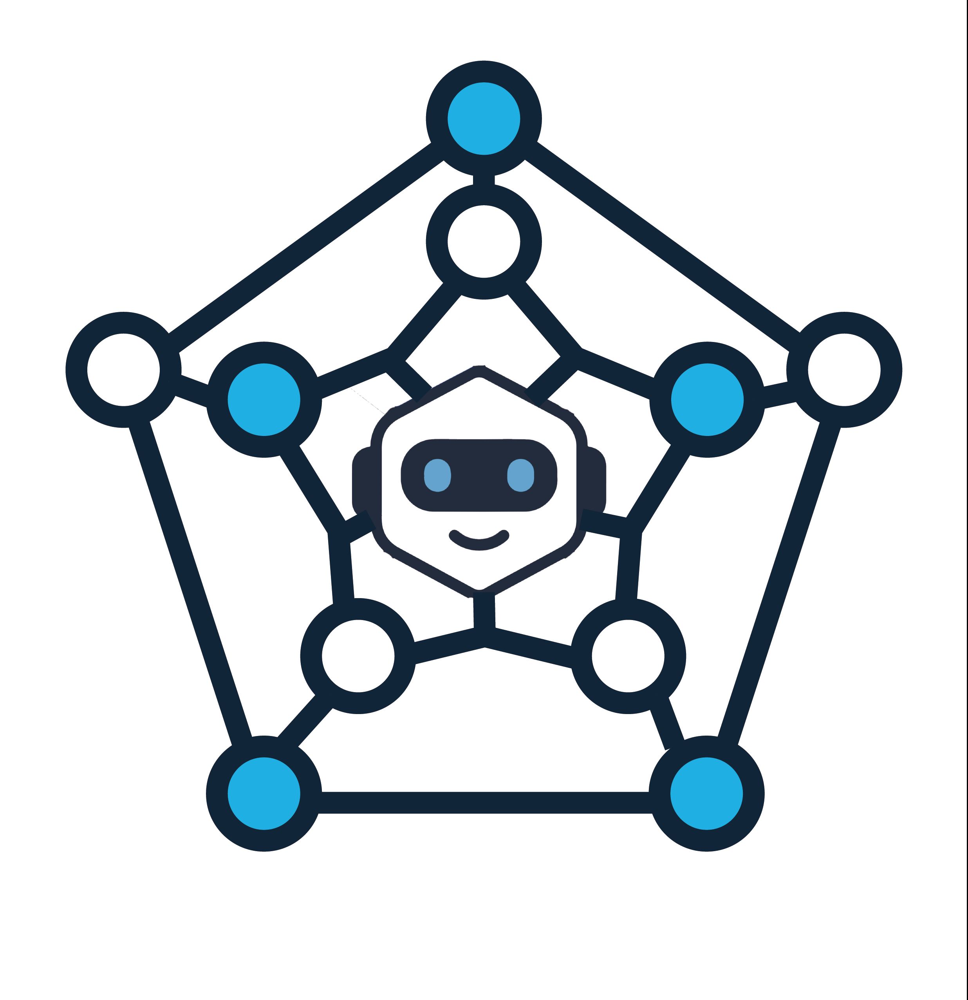
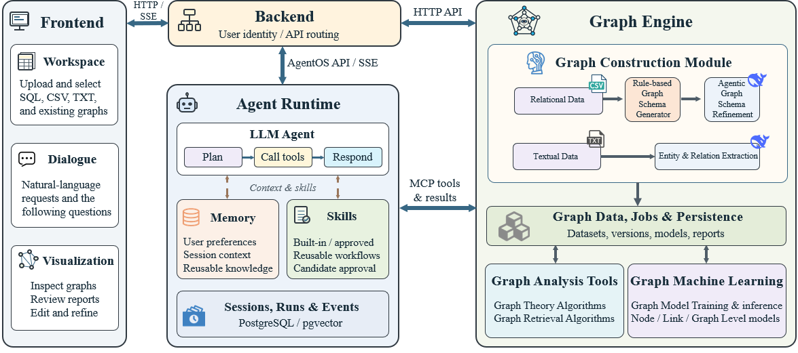

  <picture>
    <source media="(prefers-color-scheme: dark)" srcset="frontend/public/figures/igraph_dark.png">
    
  </picture>

<h1 align="center">iGraph</h1>

<strong>A Graph Data Agent for Construction, Analysis, and Learning</strong>

  <a href="https://igraph-docs.graphagent.workers.dev"><strong>📄 Technical Report</strong></a> &nbsp;·&nbsp;
  <a href="docs/guides/DEPLOYMENT.md"><strong>🚀 Deployment Guide</strong></a> &nbsp;·&nbsp;
  <a href="https://github.com/BUPT-GAMMA/iGraph/issues"><strong>💬 Feedback</strong></a>

  
  
  
  

**iGraph** brings graph construction, graph analysis, and graph machine learning into one conversational workspace.
Start with tables, text, or an existing graph, ask a question in natural language, and let the agent plan the analysis,
call tools, and explain the results with evidence you can inspect.

  

<em>From raw data to graphs, from questions to evidence.</em>

## 🔥 News

- **[2026/10/19]** We have released the current **iGraph Agent**, bringing graph construction, conversational analysis, and graph learning together in a single-user workspace. Start with the [deployment guide](docs/guides/DEPLOYMENT.md).
- **Technical report:** Explore the agent workflow, system design, and supported graph capabilities in our [online technical report](https://igraph-docs.graphagent.workers.dev).

## 💡 What is iGraph?

- **Build your graph.** Turn relational tables and text into graph data, refine the graph schema, or connect an existing graph dataset.
- **Ask and explore.** Investigate entities, trace relationships, and discover graph structures through natural-language questions and interactive visualization.
- **Analyze and learn.** Combine graph queries, graph algorithms, and graph machine learning to answer questions about nodes, links, and whole graphs.
- **Continue your work.** Keep projects, conversations, memory, and reusable skills in one workspace, and follow up on earlier results.

Included examples cover financial ownership analysis, molecular properties, and literary character relationships.

## 🚀 Get started

1. Follow the **[Deployment Guide](docs/guides/DEPLOYMENT.md)** to prepare a Linux server and start iGraph with Docker Compose.
2. Open the workspace, configure your model connection, and choose an example graph or bring your own data.
3. Ask a question, inspect the graph and results, and continue the conversation.

The current release uses a **single-user workspace**. The deployment guide covers access through an SSH tunnel,
model setup, optional GPU support, backups, and troubleshooting.

For the broader design and capabilities, read the **[Technical Report](https://igraph-docs.graphagent.workers.dev)**.
For implementation details, see the [developer documentation](docs/README.md).

## 📬 Contact

### WeChat group

Scan the QR code in WeChat to join the **iGraph user group** for questions, feedback, and discussion.
Click the image to view it at full size, or save it and select it from your album in WeChat's scanner.

  

If the QR code has expired, [open an issue](https://github.com/BUPT-GAMMA/iGraph/issues) to request an updated invitation.

## 🌟 Star History

If iGraph is useful for your work, consider giving the project a star.

<a href="https://star-history.com/#BUPT-GAMMA/iGraph&amp;Date">
  <picture>
    <source media="(prefers-color-scheme: dark)" srcset="https://api.star-history.com/svg?repos=BUPT-GAMMA/iGraph&amp;type=Date&amp;theme=dark">
    <source media="(prefers-color-scheme: light)" srcset="https://api.star-history.com/svg?repos=BUPT-GAMMA/iGraph&amp;type=Date">
    
  </picture>
</a>
