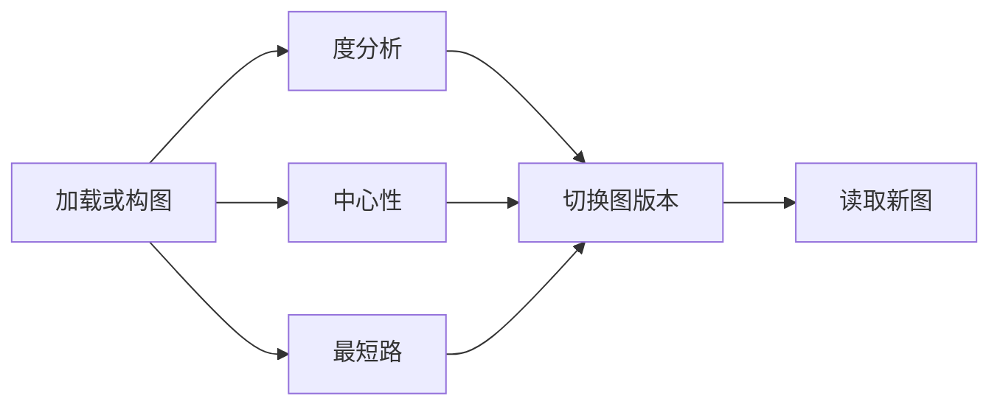

# 图工具 DAG 并行执行

默认 AgentOS 入口使用原生工具调用。每轮模型返回的调用列表按共享工具目录的读写资源生成有向无环图，无冲突节点并行运行，冲突节点按原始调用顺序执行。无需新增批量调用工具，也不改变现有工具参数。



读写冲突包括先写后读、先读后写、先写后写。只有已知参数的独立调用可以同轮提交；参数依赖工具结果时，模型先取得真实结果，再在下一轮提交，不能猜测 ID 或 revision。结果按完成时间流式发送，模型上下文按原始调用顺序保存。

## 共享工具策略

`graph_engine/tool_execution.py` 使用标准库定义工具资源契约；`graph_data_service/tool_catalog.py` 和构图目录中的每个规格都有 `execution` 元数据。新增工具必须在策略中登记；未登记工具按保守屏障执行，完整性测试会检查目录覆盖。

| 资源 | 作用域 | 典型调用 |
| --- | --- | --- |
| 当前图和图版本 | 用户 + 会话 | 分析/可视化读；加载、转换、回滚写 |
| 构图数据集 revision | 用户 + dataset_id | 状态/获取/预览读；提交优化写 |
| 保存的数据集 | 用户 | 列举读；保存写 |
| 数据集绑定 | 用户 + 会话 | 加载/保存数据集写 |
| 文档索引 | 用户 + 会话 | 上传写；检索读 |
| 分类数据集绑定 | 用户 + 会话 | 加载分类数据集写；分类图加载/训练读 |
| 模型产物 | 用户 + 会话 | 训练写；推理和结构查看读 |
| Nebula 副本 | 用户 + 会话 | 同步写；远端查询读 |

`subgraph_extraction` 默认产生新图版本，是写操作；只有显式 `create_version=false` 才按只读调度。`load_graph_from_upload` 可能修改当前图或分类数据集绑定，因此保守声明两类写资源。用户自定义工具、Skills 和生命周期工具没有已登记契约时作为屏障。

## 执行与一致性

- `agent_runtime/tool_dag.py` 在固定版本 Agno 2.9.0 的原生单工具执行流程外调度，保留工具 hooks、审批、媒体、事件和会话持久化。
- 前置节点失败、尚未完成或等待审批时，后继返回 `TOOL_DEPENDENCY_BLOCKED`，不会执行。审批恢复仍由 Agno 处理已暂停工具；模型随后重新提交被跳过步骤。没有自动重放写入。
- `GraphMCPTools` 为每次调用独立管理 MCP 连接，在返回后台句柄时等待最终 job 结果，支持嵌套 job，并拒绝循环和缺失结果。Agno 转为纯文本的 MCP 错误重新规范为失败结果。
- `graph_data_service/tool_scheduler.py` 对服务内不同请求实施相同的资源准入；只读可重叠，排队的写操作不会被后来的读操作无限插队。同用户不同会话共享的数据集 revision 也纳入冲突检查。
- 后台任务提交后持有资源直到实际工作退出。状态查询和取消不等待图写入租约，避免无法停止任务。取消普通 ProcessPool 工作时保留容量和图租约直至进程计算完成；生产受控任务仍使用可终止的隔离工作进程。
- 图快照转换移出事件循环；搜索缓存只锁短暂查找/淘汰操作，embedding 在锁外执行。

当前部署的 Graph Engine API 是单进程服务。资源准入保存在该进程中；如要让多个 API 实例同时写同一存储，需要另外提供跨进程锁或资源所有者路由。

## 并发配置

| 环境变量 | 默认 | 用途 |
| --- | --- | --- |
| `AGENT_TOOL_MAX_CONCURRENCY` | 4 | 单轮 Agent 就绪节点并发，范围 1–32 |
| `GRAPH_COMPUTE_CONCURRENCY` | min(4, CPU 数) | 普通算法进程池 worker 数 |
| `GRAPH_COMPUTE_GLOBAL_CONCURRENCY` | worker 数 | 全局普通计算并发 |
| `GRAPH_COMPUTE_PER_USER_CONCURRENCY` | worker 数 | 每用户普通计算并发；原默认 1 已解除 |
| `GRAPH_HEAVY_PER_USER_CONCURRENCY` | 1 | 训练/推理等重任务限流 |

训练保持单用户重任务限流，避免 GPU 内存和随机数状态争用。设置普通计算并发为 1 可用于串行对照；代码不依赖吞吐量或时间阈值判断正确性。

## 验证入口

```bash
python -m pytest tests/test_tool_dag.py tests/test_tool_execution_policy.py \
  tests/servers/test_parallel_compute.py tests/test_search_concurrency.py \
  tests/test_readonly_graph_tools.py
```

测试涵盖实际 Agno + MCP 包装、同轮分叉/汇合、结果顺序、并发上限、失败传播、审批恢复、后台 job 链、取消清理、真实多进程计算与串行结果对照、并发追加不丢更新，以及只读工具不改图。

构图接口与蓝色主题的功能说明见 [构图接口](GRAPH_CONSTRUCTION.md)。构图算法通过既有接口接入；没有算法时返回明确不可用状态，不产生虚构图数据。
